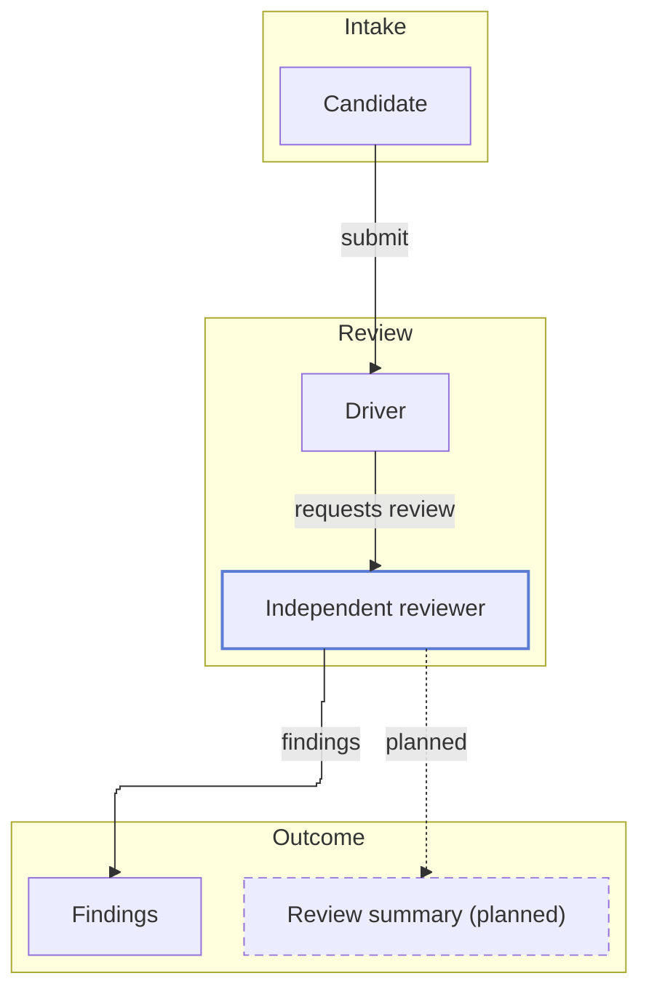
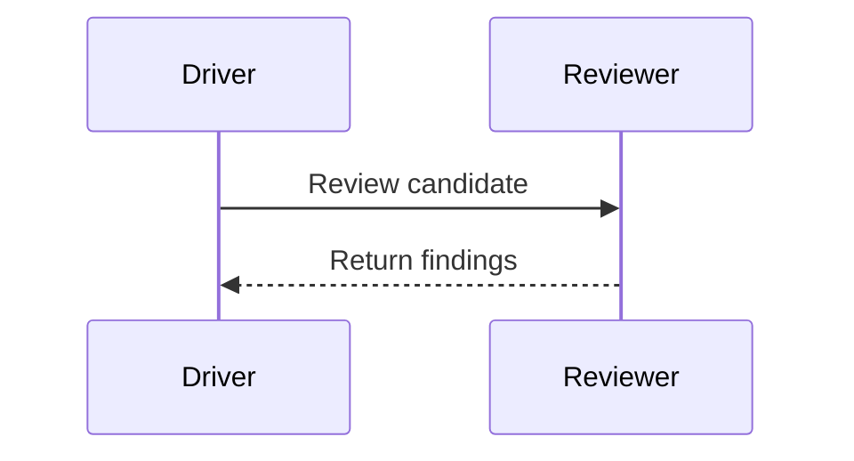

# Mermaid diagrams

Use Mermaid for chat, GitHub, and docs. Use `flowchart` for topology and
branching flows, `sequenceDiagram` for ordered exchanges, `stateDiagram-v2`
for states, `erDiagram` for data models, and `timeline` for events. Other
types need an explicit user request.

Include `accTitle` and `accDescr` in every Mermaid view. Name relationships
and keep labels short. Never use theme init in Mermaid (`%%{init}%%` or
`%%{initialize}%%`). Omit theme, themeVariables, themeCSS, look and font keys.
Use multiline YAML with nested maps and scalar values. An optional top-level
`title` can precede the config. Types without a listed config allow only a title.

Set `config.layout` to `elk` by default for `flowchart`, `stateDiagram-v2`
and `erDiagram`. Use the same default for explicitly requested
`classDiagram`, `mindmap` and `requirementDiagram`.
For a fallback, omit `layout` and put exactly one `%% layout-fallback:` comment
with a non-empty reason immediately after the diagram header.
Name the concrete target in the comment, for example
`%% layout-fallback: target uses Mermaid 11 without the ELK plug-in`.

- Flowchart config requires `nodeSpacing` and `rankSpacing` under `config.flowchart`,
  each an integer from 40 to 150. Optional `config.flowchart.curve` accepts
  `step`, `linear`, or `basis`.
- Sequence config requires `actorMargin` and `messageMargin` under
  `config.sequence`, each an integer from 40 to 150.
- Use only these keys. Omit single-line flow mappings such as `config: { ... }`.

Flowchart spacing of 90/110 gives labels and step connectors room in Pele.
Tenfold spacing shrinks labels at the same viewing width.
ELK ignores the flowchart spacing and curve keys.
Split wide Mermaid diagrams into views.
Keep estimated label size at least 12px at an 860px reading width
(`16 * min(1, 860 / renderedWidth)`).
The chat check uses a nominal 16px baseline, while edge labels render at 14px.
For ELK export, require the smallest rendered label to reach 12px in the browser
at the target width, except for the dense overview below and HTML viewers
that keep labels at intrinsic size.
Restructure diagrams that fail legibility with TB, tiers, aggregated edges or a zoom-in.
Never shrink labels to pass the legibility gate.
Density warnings prompt a split: more than 9 nodes, 12 edges or 5 participants,
labels above 40 characters, or sequence messages above 28.

Open every system-design or architecture explanation with one whole-system
overview. Use `flowchart TB` with tiered subgraphs as the default overview.
Stack tiers with about five direct nodes each. Use names with at most one status
word. Aggregate relationships to one edge per tier or component pair. Put detail
in zoom-ins after the overview.
Split only when you keep the overview.
Run the checker with `--overview`. Block 1 gets tier-size and short-label
advisories in place of general node and edge prompts.

For an overview with more than 25 edges, LR is also allowed and tiered
subgraphs are optional for LR or TB. For a dense overview with more than 25 edges,
keep labels at natural size and provide zoom or pan. The chat estimate uses
16px for this overview. Give exported SVGs an intrinsic-size scroller.
All other chat views keep the 12px gate at 860px.

Use neutral grey strokes (HSL saturation at most 0.15) and one optional
accent hue per diagram. Keep accent stroke hues within 15° of their shared
hue. Use `classDef` and node or subgraph `style` with only `fill`, `stroke`,
`stroke-width`, and `stroke-dasharray`. Set fills to `transparent` or `none`.
Use only `stroke-width` in a `linkStyle` with `default` or edge indices.
The following class definitions illustrate blue accents and two dash patterns.

```text
classDef accent stroke:#5b7bd5,stroke-width:2px
classDef planned stroke-dasharray:6 4
classDef unknown stroke-dasharray:2 3
```

Do not use `rect`, coloured `box`, or sequence `classDef` statements.
Keep status visible in text. Include a status word in every node label that
uses a dashed class.

- Flowcharts can use dashed classes with the words planned, unknown, retiring,
  open, partial, deprecated, or proposed in the node label. Dashed edges can
  use short relationship labels such as `E3`.
- Sequences mark status in message text and keep the arrow’s meaning.
- States use status label text. Keep native transitions and omit `classDef`.
- ER uses status label text. Dotted `..` means a non-identifying relationship.
- Timelines use status label text and omit `classDef`. Use `timeline TD` past
  four periods.
- In those three types use `(planned)` or `(unknown)` as the status text.

Allow semicolons in double-quoted flowchart labels and in `accTitle` and
`accDescr`. T3 rendered semicolons in quoted flowchart labels and
accessibility descriptions. The observed T3 failure was a semicolon in a
sequence participant alias.
Use a comma or dash in place of semicolons in sequence aliases and messages.
Use a comma or dash in place of semicolons in unquoted labels and in labels
outside flowcharts.
Keep brackets and parentheses out of participant aliases. Put status in message
text. Use `✱` for an asterisk in a flowchart label.

## Canonical overview and zoom-in





## Check and render

Run `mermaid-check.js` on every Mermaid view before delivery. Before posting
any Mermaid block in chat, run `mermaid-check.js` to parse and render that block
with pinned Pele.
From the installed Explain skill directory, check reviewed Markdown or raw
`.mmd` source with Bun.

```sh
bun ../axstack/scripts/mermaid-check.js --help
bun ../axstack/scripts/mermaid-check.js --overview --svg-out ./svg review.md
```

Diagram presence is required by default (`--expect`). Use `--no-expect` for
optional Markdown diagrams, `--pele <path>` for another copy of the pinned
bytes, and `--allow-type <type>` for an explicitly requested Pele type.
Exit codes are 0 for pass, 1 for an input, contract or render failure, 2 for
usage and 3 for a missing, invalid or blocked renderer. Exit 3 holds visual
delivery under Explain's [Delivery](delivery.md). Export all views from one
input for distinct SVG IDs. With `--svg-out`, Chromium runs the pinned standalone Mermaid
bundle offline for ELK-capable types and Pele renders the other types. For a
recorded layout fallback, Chromium uses Dagre. Use `--browser <path>` when
Chromium is outside the usual locations. Use `--width <px>` to check a
specific available figure width for the SVG label gate. The SVG check defaults
to 860px.

A Chromium sandbox startup failure holds SVG export with exit 3. Prefer a
host with a working Chromium sandbox. For trusted local diagrams on a host
that cannot start the sandbox, explicitly pass `--browser-no-sandbox` to
disable Chromium's process isolation. The offline exporter still uses the
hash-verified vendored bundle and a page CSP with `connect-src 'none'`, and
blocks network resource loading. Chromium keeps its sandbox by default.

## Render proof

A checker pass proves contract compliance and pinned-pele parse and size on
the exact source bytes. Record the Pele version and per-block source SHA-256.
Pinned Pele renders ELK input using its default layout, leaving ELK geometry
unmeasured in the chat check. T3 chat accepts `layout: elk` and lays out diagrams
with Pele. GitHub's Mermaid 12.3.0 viewer registers ELK, as seen in its bundle
and a replay of the viewer. An issue-page render and mermaid.live remain
unverified. See [issue #714](https://github.com/axatbhardwaj/axstack/issues/714).
A checker pass never proves T3 or GitHub appearance.
Save the posted Markdown and its SHA-256 with the review. For embeds, the
reviewer matches embedded SVG bytes to the checker-printed SHA-256.
Record `T3 render: unobserved` unless an actual inline render is observed.
Claim GitHub or docs fidelity only after a fixture render on that host.

## HTML figures

Use the figure export to build inline T3 pages, standalone HTML and Publish articles.

```sh
bun ../axstack/scripts/mermaid-check.js --overview --width 860 --figure-out ./figures review.md
```

Set `--width` to the available content column in CSS pixels. Omit `--overview`
if the input has no system overview. In block order, insert each reported
`mermaid-<block>-<source-prefix>.html` snippet where the diagram belongs.
The exporter emits viewer markup when a diagram has more than 25 edges or
its intrinsic width exceeds the column. Smaller diagrams are static figures.
The 12px browser label floor uses intrinsic width for viewer figures.
Raw SVG export is also available with `--svg-out`.

Inline [diagram-viewer.css](../assets/diagram-viewer.css) once in a `<style>`
element and use the [figure theme mapping](inline-pages.md#embed-mermaid).
When a snippet has `data-diagram-viewer`, inline
[diagram-viewer.js](../assets/diagram-viewer.js) once in a `<script>` element
after the figures. Keep the snippets and SVG bytes intact for review.
The script enhances each viewer in place. The scroll frame and Fit checkbox
work before enhancement. Keep the exact-byte page scan and interactive
browser verification.

## Embeds

Follow [Inline pages](inline-pages.md#embed-mermaid) or
[Publish](../../axstack-publish/SKILL.md#2-prepare-the-final-artifact).
