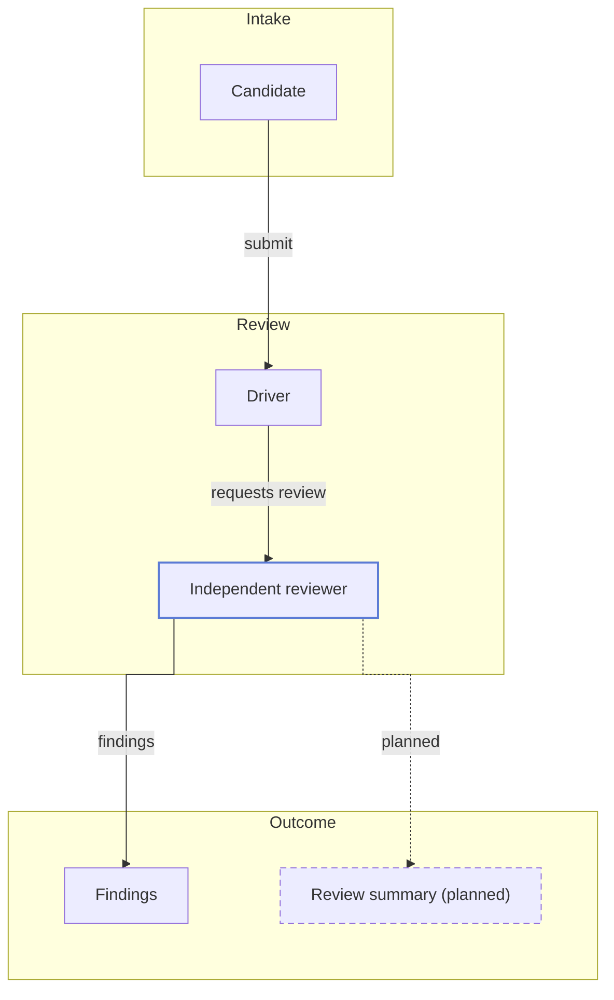
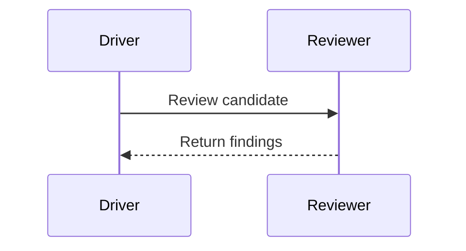

# Mermaid diagrams

Use Mermaid for chat, GitHub, and docs. Use `flowchart` for topology and
branching flows, `sequenceDiagram` for ordered exchanges, `stateDiagram-v2`
for states, `erDiagram` for data models, and `timeline` for events. Other
types need an explicit user request.

Include `accTitle` and `accDescr` in every Mermaid view. Name relationships
and keep labels short. Never use theme init in Mermaid (`%%{init}%%` or
`%%{initialize}%%`). Omit theme, themeVariables, themeCSS, look and font keys.
Match the examples' multiline YAML for flowcharts and sequences. An optional
top-level `title:` can precede the config. Other types allow only a title.

Flowchart spacing of 90/110 gives labels and step connectors room. Tenfold
spacing shrinks labels at the same viewing width.
Split wide Mermaid diagrams into views.
Keep estimated label size at least 12px at an 860px reading width
(`16 * min(1, 860 / renderedWidth)`).
Restructure diagrams that fail legibility with TB, tiers, aggregated edges or a zoom-in.
Never shrink labels to pass the legibility gate.
Density warnings prompt a split: more than 9 nodes, 12 edges or 5 participants,
labels above 40 characters, or sequence messages above 28.

Open every system-design or architecture explanation with one whole-system
overview in `flowchart TB`. Stack tiered subgraphs with about five direct nodes
each. Use names with at most one status word. Aggregate relationships to one edge
per tier or component pair. Put detail in zoom-ins after the overview.
Split only when you keep the overview.
Run the checker with `--overview`. Block 1 needs a subgraph and gets tier-size
and short-label advisories in place of general node and edge prompts.

Use at most two accent nodes, in a flowchart only. Use only these classDefs
when the type allows them.

```text
classDef accent stroke:#5b7bd5,stroke-width:2px
classDef planned stroke-dasharray:6 4
classDef unknown stroke-dasharray:2 3
```

Do not use `style`, `linkStyle`, `rect`, coloured `box`, or sequence
`classDef` statements. Keep status visible in text:

- Flowcharts use a dashed class and a visible `(planned)` or `(unknown)` node
  label. Status edges use `-.->` and label the edge `planned` or `unknown`.
- Sequences mark status in message text and keep the arrow’s meaning.
- States use status label text. Keep native transitions and omit `classDef`.
- ER uses status label text. Dotted `..` means a non-identifying relationship.
- Timelines use status label text and omit `classDef`. Use `timeline TD` past
  four periods.
- In those three types use `(planned)` or `(unknown)` as the status text.

## Canonical overview and zoom-in





## Check and render

Run `mermaid-check.js` on every Mermaid view before delivery.
From the installed Explain skill directory, check reviewed Markdown or raw
`.mmd` source with Bun.

```sh
bun ../axstack/scripts/mermaid-check.js --help
bun ../axstack/scripts/mermaid-check.js --overview --svg-out ./svg review.md
```

Diagram presence is required by default (`--expect`). Use `--no-expect` for
optional Markdown diagrams, `--pele <path>` for another copy of the pinned
bytes, and `--allow-type <type>` for an explicitly requested Pele type.
Exit codes are 0 for pass, 1 for an input, contract or render failure, 2 for
usage and 3 for a missing or invalid renderer. Exit 3 holds visual delivery
under Explain's [Delivery](delivery.md). Export all views from one input for
distinct SVG IDs.

## Render proof

A checker pass proves contract compliance and pinned-pele parse and size on
the exact source bytes. Record the Pele version and per-block source SHA-256.
A checker pass never proves T3 or GitHub appearance.
Save the posted Markdown and its SHA-256 with the review. For embeds, the
reviewer matches embedded SVG bytes to the checker-printed SHA-256.
Record `T3 render: unobserved` unless an actual inline render is observed.
Claim GitHub or docs fidelity only after a fixture render on that host.

## Embeds

Follow [Inline pages](inline-pages.md#embed-mermaid) or
[Publish](../../axstack-publish/SKILL.md#2-prepare-the-final-artifact).
